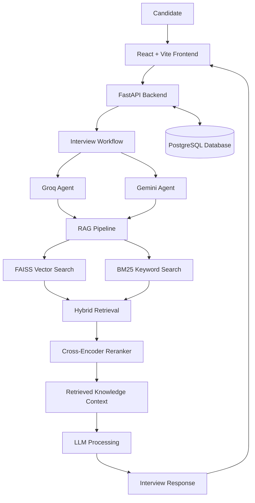

# 🤖 AI Multi-Agent Interview System

An AI-powered technical interview platform built with **Multi-Agent AI, Large Language Models (LLMs), Retrieval-Augmented Generation (RAG), and hybrid information retrieval**. The system combines Groq and Gemini integrations with a knowledge retrieval pipeline to support interview question generation, answer evaluation, and performance tracking.

<p align="center">
  <strong>Generative AI · Agentic AI · RAG · NLP · Full-Stack Development</strong>
</p>

## 📌 Project Overview

The AI Multi-Agent Interview System is designed to help candidates practice technical interviews through an interactive web application.

It combines specialized AI agent modules, LLM-powered processing, and a retrieval pipeline that uses semantic and keyword search to find relevant technical knowledge. The backend manages interview sessions and communicates with the frontend, while PostgreSQL provides persistent storage.

### 🎯 Objectives

- Build an AI-powered technical interview practice platform.
- Integrate multiple LLM providers for AI-driven processing.
- Improve response relevance using Retrieval-Augmented Generation.
- Combine vector search and keyword search for knowledge retrieval.
- Support interview session management and performance tracking.
- Develop a full-stack application with a modern web interface.

## ✨ Key Features

- **Multi-Agent AI:** Separate agent modules for LLM-powered interview-related tasks.
- **Multiple LLM Providers:** Groq and Gemini API integration.
- **RAG-Based Knowledge Retrieval:** Retrieve relevant technical information to support LLM responses.
- **Hybrid Search:** Combine FAISS vector retrieval and BM25 keyword retrieval.
- **Cross-Encoder Reranking:** Improve the ordering of retrieved passages based on relevance.
- **Technical Interview Practice:** Support topic-based interview sessions and questions.
- **Answer Evaluation:** AI-assisted processing of candidate answers.
- **Adaptive Interview Flow:** Support interview progression and difficulty-related logic.
- **Interview History:** Retrieve previous interview sessions and their status.
- **Persistent Storage:** PostgreSQL-backed storage for interview-related data.
- **Web Interface:** React and Vite frontend connected to a FastAPI backend.

## 🏗️ System Architecture



*Architecture overview: the exact execution path and responsibilities depend on the implementation of the agent workflow.*

## 🧠 AI and RAG Pipeline

The project combines LLM-powered processing with retrieval-based knowledge grounding.

### Retrieval workflow

1. **Knowledge loading:** Prepare technical interview knowledge for retrieval.
2. **FAISS retrieval:** Find semantically similar knowledge using vector search.
3. **BM25 retrieval:** Find relevant content through keyword matching.
4. **Hybrid retrieval:** Combine results from semantic and lexical retrieval.
5. **Cross-encoder reranking:** Reorder retrieved passages by query relevance.
6. **LLM processing:** Use the available context to support interview-related generation or evaluation.

```text
Interview Query
      |
      v
  FAISS + BM25
      |
      v
  Hybrid Retriever
      |
      v
 Cross-Encoder Reranker
      |
      v
 Relevant Knowledge
      |
      v
 Groq / Gemini Processing
      |
      v
 Interview Response
```

## 🧰 Technology Stack

| Category | Technologies |
|---|---|
| Frontend | React, Vite |
| Backend | Python, FastAPI |
| LLM Providers | Groq API, Gemini API |
| AI Architecture | Multi-Agent Systems, LLM Integration |
| Retrieval-Augmented Generation | RAG |
| Vector Search | FAISS |
| Keyword Search | BM25 |
| Reranking | Cross-Encoder, Sentence Transformers |
| Database | PostgreSQL |
| Authentication | JWT, where configured |
| API Communication | REST APIs |
| Development Tools | Git, GitHub, Python virtual environment |

## 📂 Project Structure

```text
Multi-agent-interview-system/
│
├── agents/
│   ├── groq_agent.py
│   └── gemini_agent.py
│
├── ai-interview-frontend/
│   ├── src/
│   ├── public/
│   ├── package.json
│   └── ...
│
├── api/
├── data/
│   └── interview_knowledge.json
│
├── database/
├── models/
│
├── rag/
│   ├── load_knowledge.py
│   ├── bm25_retriever.py
│   ├── hybrid_retriever.py
│   └── reranker.py
│
├── workflows/
├── .env.example
├── .gitignore
├── main.py
├── requirements.txt
└── README.md
```

*This tree shows the known modules and may omit additional files or nested directories.*

## ⚙️ Installation and Setup

### Prerequisites

Install the following:

- Python 3.11 or a version compatible with the project's dependencies
- Node.js and npm
- PostgreSQL
- Git
- API credentials for the LLM providers you want to use

### 1. Clone the repository

```bash
git clone https://github.com/Dinesh-05-G/Multi-agent-interview-system.git
cd Multi-agent-interview-system
```

### 2. Set up the Python environment

On Windows PowerShell:

```powershell
python -m venv .venv
.\.venv\Scripts\Activate.ps1
python -m pip install --upgrade pip
pip install -r requirements.txt
```

### 3. Configure environment variables

Create a local `.env` file in the project root using the environment variable names required by your backend.

If you have committed an `.env.example` template, copy it:

```powershell
Copy-Item .env.example .env
```

Configure the required values for:

- Groq API key
- Gemini API key
- PostgreSQL connection settings
- JWT secret, if authentication is enabled
- Other application-specific configuration

**Security:** Never commit `.env` or real credentials to GitHub. Keep only placeholder values in `.env.example`.

### 4. Configure the database

Start PostgreSQL and create the database required by the application. Set the connection details in your local `.env` file.

Run the project's database initialization or migration commands, if required.

The exact database name and migration command depend on the backend implementation.

### 5. Start the backend

Run the Uvicorn command matching the module that defines your FastAPI application.

For example, if the FastAPI instance is defined as `app` in `api/main.py`:

```powershell
python -m uvicorn api.main:app --reload
```

If your application entry point is elsewhere, replace `api.main:app` with the correct Python module and application variable.

The typical local backend address is:

```text
http://127.0.0.1:8000
```

If enabled, the interactive API documentation is available at:

```text
http://127.0.0.1:8000/docs
```

### 6. Start the frontend

Open another terminal:

```powershell
cd ai-interview-frontend
npm install
npm run dev
```

Open the local URL printed by Vite, commonly:

```text
http://localhost:5173
```

Ensure the frontend API configuration points to the backend address.

## 🔌 API Documentation

The backend uses FastAPI for API development. When enabled, Swagger UI provides interactive documentation for available endpoints.

| Endpoint/resource | Purpose |
|---|---|
| `/docs` | Interactive API documentation |
| `/openapi.json` | OpenAPI specification |
| Interview APIs | Interview sessions and questions |
| Interview history APIs | Previous session information |
| Authentication APIs | User authentication, where configured |

Consult the running application's OpenAPI specification for the exact routes, request formats, and response schemas.

## 🗃️ Data and Session Management

PostgreSQL is used for persistent interview-related information in the described implementation.

The backend supports interview session management, while the frontend provides the interface for interacting with the application and reviewing available interview history.

## 🔐 Security

- Keep API keys and database credentials in environment variables.
- Never upload `.env`, `.venv`, or `node_modules`.
- Use secure authentication secrets and appropriate token expiration.
- Validate incoming API requests.
- Protect user-specific interview data and session history.
- Avoid exposing secrets in logs or error messages.

## 🧪 Testing

Run the tests available in the repository using the project's configured test framework.

For Python projects using pytest:

```powershell
pytest
```

For frontend projects with a configured test script:

```powershell
cd ai-interview-frontend
npm test
```

These commands work only if the corresponding test framework and scripts are configured. Add project-specific test instructions as the test suite evolves.

## 🔮 Future Enhancements

- More specialized AI agents and improved agent coordination.
- More detailed evaluation rubrics and personalized feedback.
- Expanded interview knowledge bases.
- Enhanced interview analytics and progress visualization.
- Streaming AI responses.
- Docker-based deployment and CI/CD.
- **MCP integration** for standardized connections between AI applications and external tools, if implemented in a future version.

> **MCP status:** Model Context Protocol integration has not been confirmed in the current project. It should not be considered an implemented feature unless an MCP client and the required MCP server integrations are added and tested.

## 👨‍💻 Author

**Dinesh G**

B.Tech — Artificial Intelligence and Data Science

Interests: Generative AI, Multi-Agent Systems, RAG, NLP, Machine Learning, and Backend Development.

- **GitHub:** [Dinesh-05-G](https://github.com/Dinesh-05-G)
- **Repository:** [Multi-agent-interview-system](https://github.com/Dinesh-05-G/Multi-agent-interview-system)


---

⭐ If you find this project interesting, consider starring the repository.
